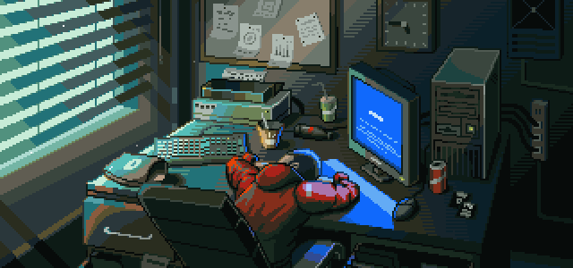

<h1 align="center">Hey  I'm mqu-1</h1>

## 📌 About Me
- 💡 I can't decide between breaking into networks and building them — so I do both. Network security by night, computer science by day, zero formalities in between. If it has packets, pointers, or a terminal, I'm probably already in it (legally... mostly).
- 🔐 I like my coffee black and my packets captured.

## 📊 GitHub Stats & Trophies

  

## 🛠️ Languages & Tools

> ## Programming Languages

     

> ## Frontend

  

> ## Backend

 

> ## Database

> ## DevOps & Cloud

  

> ## Tools

    

## 🔗 Connect with Me

 

  

